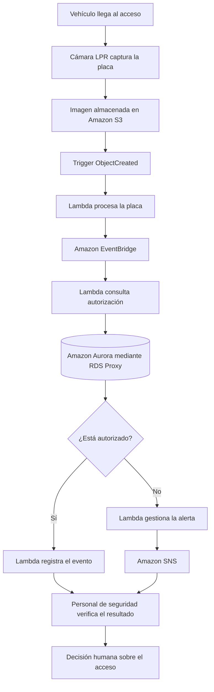

# Flujo del sistema ARTECO

## 1. Objetivo

El sistema ARTECO busca mejorar el control de ingreso y salida de vehículos en condominios mediante la identificación de placas, la consulta de autorizaciones, el registro de eventos y la generación de alertas ante posibles irregularidades.

## 2. Diagrama del flujo propuesto

**Nota:** este diagrama representa la arquitectura funcional propuesta. No significa que todos sus componentes estén desplegados actualmente.

## 3. Triggers y eventos

- **ObjectCreated:** inicia el procesamiento cuando se almacena una nueva imagen en S3.
- **PlacaProcesada:** comunica que terminó la identificación de la placa.
- **ValidacionFinalizada:** permite registrar el resultado de la consulta.
- **ValidacionRechazada:** permite activar el proceso de alerta mediante EventBridge y SNS.

## 4. Infraestructura desplegada

La ejecución de Terraform en AWS terminó correctamente y reportó cuatro recursos creados, cero modificados y uno destruido.

El registro confirma la creación del bucket:

`arteco-control-demo-755909808380-48271`

También se configuraron recursos asociados al versionado, el bloqueo del acceso público y el cifrado del lado del servidor.

La ejecución por sí sola no demuestra que Lambda, EventBridge, Aurora, RDS Proxy o SNS estén desplegados. Estos componentes deben verificarse en el código y en la consola de AWS.

## 5. Métricas y rendimiento

Los objetivos de referencia definidos para el proyecto son:

- Consulta de autorización: P95 menor o igual a 2 segundos.
- Procesamiento de placa: P95 menor o igual a 3 segundos.
- Comparación facial: P95 menor o igual a 3 segundos.
- Carga de referencia: 6,53 eventos por minuto.

Para evaluar estos objetivos se deben instrumentar las funciones y registrar los tiempos de inicio y finalización. CloudWatch podrá utilizar esas métricas para visualizar el rendimiento y configurar alarmas.

## 6. Seguridad

- Utilizar IAM con permisos mínimos necesarios.
- Mantener el bloqueo de acceso público de S3.
- Aplicar cifrado a los objetos almacenados.
- Utilizar GitHub Actions con autenticación OIDC para ejecutar Terraform sin guardar claves permanentes de AWS en el repositorio.

## 7. Decisión final

El sistema proporciona información para apoyar al personal de seguridad. La decisión de autorizar el ingreso o la salida permanece bajo supervisión humana; el sistema no debe abrir automáticamente el portón.
